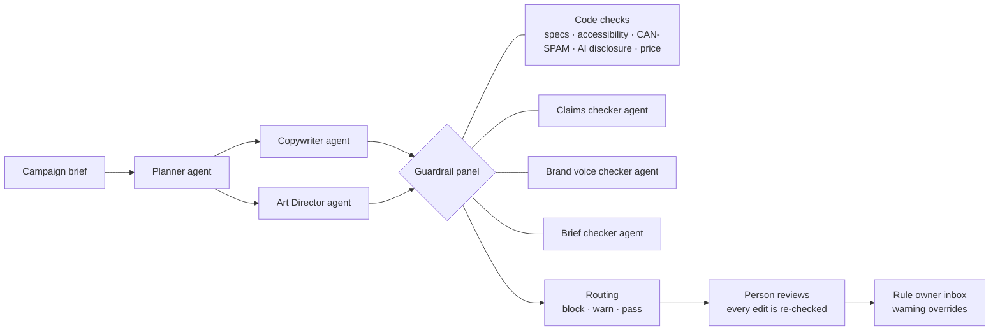

# Umbu

**Content rooted in your context.**

Generative AI cut the cost of making marketing content. In the enterprise, it multiplied the cost of approving it: a team that can generate 40 variants in the time it took to write one still has to clear every one of them through brand, legal and compliance review.

Umbu is a prototype of a context and governance layer for generative marketing. Agents plan a campaign, write the copy and generate the images. Then every output is checked against the brand's voice, approved claims, channel specs and regulations before a person sees it, whether an AI or a person wrote it.

I built Umbu as my capstone for Maven's AI PM certification, and I'm continuing to develop it. It is a working proof of concept, not a product.

> **Demo brand:** Northwind is a fictional outdoor-gear company. All product facts and test results are invented for the demo.

<!-- Add 2–3 screenshots of the Review screen and the Owner inbox here, e.g.  -->

## How it works



- **Six agents on Microsoft Foundry:** three create (Planner, Copywriter, Art Director) and three check (claims, brand voice, campaign brief), alongside deterministic code checks.
- **Every rule has an ID and an owner,** stored as plain files in [`context/`](context/): brand voice, approved and prohibited claims, regulations, channel specs, accessibility and brief requirements.
- **Every finding cites the rule it breaks,** quotes the exact words and proposes a compliant rewrite.

## What I did

I worked on Umbu end to end as product manager, designer and builder:

- **Defined the product:** the problem, the target user (marketing operations leads in enterprises where a wrong claim is costly), scope, success metrics and the PRD.
- **Designed the context layer:** more than 45 rules across brand voice, claims, regulations, channel specs and accessibility, each with an ID and a named owner.
- **Built the agent workflow** on Microsoft Foundry in Python, including the guardrail panel, routing and a Streamlit review app.
- **Designed and ran the evaluation** described below.
- **Built it with AI-assisted coding,** using Claude as a coding partner. I owned the product decisions, architecture, rules and evals.

## Key design decisions

- **Code for anything measurable, models for anything that needs judgment.** Lengths, prices, footers, alt text and AI disclosure are checked in code, which is exact and repeatable. Claims and brand voice need a model.
- **Blocks can't be approved.** A reviewer has to fix the issue, and the fix is re-checked, including fixes that accept the AI's own suggestion.
- **Fail toward a person.** If a checker errors or times out, the content is blocked and routed to a person (SYS-01). Nothing passes by default.
- **Overrides are governed.** Approving over a warning requires a written reason, which goes to the rule's owner so repeat disagreements get settled at the standards level.
- **Design for non-determinism.** Model verdicts vary between runs, so borderline calls go to a person instead of being re-run until they pass.

## Evaluation

**Question:** does the guardrail panel catch the violations it should, without blocking clean content?

**Method:** 35 seeded cases (9 clean, 22 single violations covering every rule family, 2 multi-violation edits and 2 that should only warn), each run 3 times through the live agents. That's 105 checks, scored by code-based evaluators in [`eval/scoring.py`](eval/scoring.py) and logged to Foundry's Evaluations view.

**Results on a seeded test set** (Oct 9, 2026, [`eval/results/20261009-145405/`](eval/results/20261009-145405/)):

| Metric | Result | Target |
|---|---|---|
| Violations blocked | 99% (71/72) | ≥ 95% |
| Clean copy wrongly blocked | 4% (1/27) | ≤ 10% |
| Verdict accuracy (pass / warn / block) | 90% (94/105) | ≥ 80% |
| Cited the expected rule | 99% (77/78) | ≥ 90% |
| Code-checked rules | 100% (21/21) | 100% |
| Same block decision across 3 runs | 94% (33/35) | ≥ 95% |
| Same exact verdict across 3 runs | 77% (27/35) | ≥ 90% |

**Limits of this eval:** the answer key is seeded and synthetic, written by the same person who wrote the rules, for one fictional brand. It is not a held-out set. The one missed block and the one false block were both model-judgment calls that changed between runs. Consistency is the main gap, which is why warnings route to a person.

**Next:** a held-out set written by someone other than the rule author, a larger set of briefs, and per-metric thresholds as quality gates.

## Built vs. not yet built

**Built:** the six agents, the context layer, code checks, the guardrail panel and routing, the review app with enforced blocking and re-checks, the decision record, the rule-owner inbox, and the evaluation.

**Not yet built:** agents that fix their own blocked content, integrations with workflow and asset tools (the review app stands in for them), tracing and observability, and support for multiple brands.

---

## For developers

### Repository map

| Path | What it is |
|---|---|
| `context/` | The brand's rules: brand voice (BV), approved claims (CL, AM), prohibited claims (CL-P), regulations (REG), channel specs (CH, ACC), brief mandatories (BR), rule owners |
| `prompts/` | Instructions for the six Foundry agents |
| `setup_agents.py` | Registers the agents in Microsoft Foundry (a new version only when instructions change) |
| `run_planner.py` → `run_creative.py` → `run_checks.py` | The pipeline, one step each. `run_all.py` runs them in order |
| `scenarios/vp_edits.json` | Demo scenario: a VP of Sales edits the copy after the agents finish |
| `umbu/` | Shared code: Foundry client, guardrail panel, code checks, brief checks, governance, UI helpers |
| `app.py`, `views/` | Streamlit app: Home, Review, Owner inbox |
| `eval/`, `run_eval.py`, `log_eval_to_foundry.py` | The evaluation |
| `runs/` | Pipeline outputs (not committed) |

### How to run

**You need:** Python 3.11+, the Azure CLI, and a Microsoft Foundry project with three model deployments: a reasoning model (Planner, claims checker), a smaller text model (Copywriter, Art Director, brand voice and brief checkers) and an image model. The demo used `gpt-5`, `gpt-5-mini` and `gpt-image-2`.

```bash
git clone https://github.com/lerossisantos/umbu.git
cd umbu
python3 -m venv .venv
source .venv/bin/activate
pip install -r requirements.txt
az login
```

Create a `.env` file in the project folder:

```
FOUNDRY_PROJECT_ENDPOINT=https://<your-resource>.services.ai.azure.com/api/projects/<your-project>
PLANNER_DEPLOYMENT=gpt-5
TEXT_DEPLOYMENT=gpt-5-mini
IMAGE_DEPLOYMENT=gpt-image-2
```

Then:

```bash
python setup_agents.py                      # once, and again after you change a file in prompts/ or context/
python run_all.py --scenario vp_edits       # brief → plan → copy + images → checks, plus the VP-edits copy
streamlit run app.py                        # open the app at http://localhost:8501
```

### Running the evaluation

```bash
python run_eval.py --runs 1 --limit 3       # smoke test
python run_eval.py                          # 35 cases x 3 runs → eval/results/<time>/results.md
python log_eval_to_foundry.py --safety      # log to Foundry (+ optional built-in safety evaluator)
```

### Data sources

The rules are simplified from real, citable sources: GOV.UK style guide (OGL v3), USWDS and 18F (CC0), Google Ads specs, Can I Email (MIT), WCAG 2.2, FTC Endorsement and Green Guides, CAN-SPAM and EU AI Act Art. 50. **Not legal advice.**

## Copyright

© 2026 Leticia Rossi. All rights reserved. You're welcome to read the code; please don't copy or reuse it without permission.
